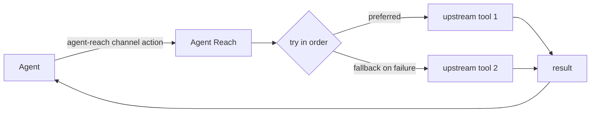

<h1 align="center">👁️ Agent Reach</h1>

<p align="center">
  <strong>Let your AI agent reach the parts of the internet it can't reach on its own</strong>
</p>

<p align="center">
  Login-walled platforms, what's inside videos, Chinese platforms, clean structured data. One command.
</p>

<p align="center">
  <a href="LICENSE"></a>
  <a href="https://www.python.org/"></a>
  <a href="https://github.com/moynihan/Agent-Reach/stargazers"></a>
</p>

<p align="center">
  <a href="#quick-start">Quick Start</a>
</p>

---

## Why Agent Reach?

**Agent Reach connects your agent to the internet for real, giving it the platforms and abilities it can't reach on its own.**

CLI agents such as Claude Code, Codex, Hermes Agent and OpenClaw come with web search and page fetching, but they mostly can't reach:

- **Features that need a login**: listing an X account's posts, searching Reddit, reading LinkedIn job details or XiaoHongShu notes.
- **What's inside video**: YouTube subtitles and speech-to-text.
- **Chinese platforms**: XiaoHongShu and Xueqiu, which general search covers poorly.
- **Clean structured data**: Xueqiu quotes, GitHub repos and issues, already cleaned up.

Agent Reach installs and tests the tools behind these platforms for you, so your agent can use them with one command:

```bash
agent-reach channels                          # which channels exist and what each can do
agent-reach youtube search "LLM agents"       # agent-reach <channel> <action> [args]
agent-reach read https://github.com/yt-dlp/yt-dlp   # picks the channel from the link
```

### ✅ Before you start, you might want to know

- **Which agents?** Every agent.
- **Does it touch my browser and accounts?** Login channels use Agent Reach's own browser, in the background without windows. The first time a site is used, that site's login is copied over from your Chrome; your browser is not changed and passwords are never read. The copied login is usually your main account, so switching to a secondary one is recommended, see Security below.

---

## Supported Platforms

This table reflects the current release.

| Channel | Level | What it does | Needs |
|---|---|---|---|
| github | default | search repos, read a repo/README, read issues and PRs with comments | nothing |
| youtube | default | video info, search, subtitles, speech-to-text | nothing; speech-to-text needs a Groq or OpenAI key |
| web | default | web search, page reading (fallback) | nothing |
| reddit | optional | search posts, read text/comments, browse a subreddit | login |
| linkedin | optional | search jobs, read job details | public jobs need nothing; in-site search needs a login |
| xiaohongshu | optional | search notes, read text, view comments | login |
| xueqiu | optional | real-time quotes, stock search, hot posts, hot stocks | quotes need nothing; hot posts and stocks need a login |
| boss | optional | job and JD search | login |
| twitter | experimental | search tweets, profiles, user tweets, threads | login |
| facebook | experimental | search, profiles | login |
| instagram | experimental | user search, profiles, user posts | login |

- **default**: works right after install; you can remove one, and updates won't add it back.
- **optional**: say "add XX" to turn it on; whatever it needs is installed for you.
- **experimental**: works, but the platform fights automation harder and it can break at any time.

---

## Quick Start

Send this to your agent:

```
Install Agent Reach: https://raw.githubusercontent.com/moynihan/Agent-Reach/main/docs/install.md
```

Whether you're installing or upgrading, this one command is all you need.

The agent does the rest. Along the way you may be asked to:

- **Let it run commands**: if the agent says it can't run commands, turn on command execution in its settings.
- **Allow installing uv**: uv is a small tool that installs command-line programs; no admin password needed. The agent installs it first if it's missing and tells you.
- **Pick optional channels**: afterwards the agent tells you what works now (web, YouTube, GitHub) and what else you can add. Pick now, or later just say "add Xiaohongshu"; one command sets it up.

About logins: some platforms reuse the logins already on your computer. Want a specific account instead, such as a secondary one? Just tell your agent. The agent never logs in for you and never asks for your password.

> ⚠️ The PyPI package named `agent-reach` is NOT this project. Don't install it from PyPI; use the GitHub URL in install.md.

---

## After Install: Managing It

Everything Agent Reach installs (each channel's tools, logins and settings) lives in one folder on your computer (`~/.agent-reach/`) instead of being scattered around. That makes upgrading, managing and removing it easy: one sentence does it.

Just tell your agent in plain words:

| You say | What it does |
|---|---|
| "How is Agent Reach doing?" | tells you which channels work right now, and which worked before but broke since |
| "Add Xiaohongshu" / "Remove Xiaohongshu" | turns it on and installs what it needs / turns it off and clears its login and private tools |
| "My Xiaohongshu login expired" / "Switch accounts" / "Log out" | opens a login window where you sign in yourself / clears that site's login |
| "Upgrade Agent Reach" | updates the program and every channel's tools in one go, and tells you anything left to do |
| "Uninstall Agent Reach" | lists what would be removed first, and removes it once you confirm |
| "Let my other AI use it too" | gives that AI its own copy of the instructions |

When something goes wrong, your agent tells you which platform, why, and what to do next. Common problems: [troubleshooting.md](docs/troubleshooting.md).

---

## Design Philosophy

### 🔌 Every platform = an ordered list of tools (primary + fallbacks)

Each action on each platform has an ordered list of tools to try. Reading a GitHub repo tries the gh CLI first and falls back to the public REST API; reading a web page tries Jina Reader, then Exa.



Platforms change and tools break all the time. Switching tools only reorders that list; the way your agent uses Agent Reach stays the same.

---

## Security

- **Read-only**: it searches and reads; it never posts, comments, likes or sends messages.
- **It never logs in for you or asks for your password.** Some platforms reuse a login already on your computer (that one site only, your browser unchanged); a login window opens only when you really need to sign in again, and you do it yourself.
- **The dedicated browser is open to this computer only**; other machines can't connect to it.
- **Use a secondary account.** The reused login is usually your main account, and platforms may restrict accounts used for automation. To switch, just tell your agent.
- **Never paste keys into a chat**: run `agent-reach configure groq-key` in your own terminal to enter one.

### 🗑️ Uninstall

Tell your agent "Uninstall Agent Reach". It lists what would be removed first and removes it once you confirm. Only what Agent Reach installed is removed; your other files and browsers stay. At the end it tells you how to remove the program itself.

---

## Credits

Forked from [Panniantong/Agent-Reach](https://github.com/Panniantong/Agent-Reach) by Neo Reid; this fork is English-only, drops the Chinese-platform channels and pins its third-party downloads.

Upstream tools: [OpenCLI](https://github.com/jackwener/opencli) · [boss-agent-cli](https://github.com/can4hou6joeng4/boss-agent-cli) · [yt-dlp](https://github.com/yt-dlp/yt-dlp) · [Jina Reader](https://github.com/jina-ai/reader) · [Exa](https://exa.ai)

## License

[MIT](LICENSE)
